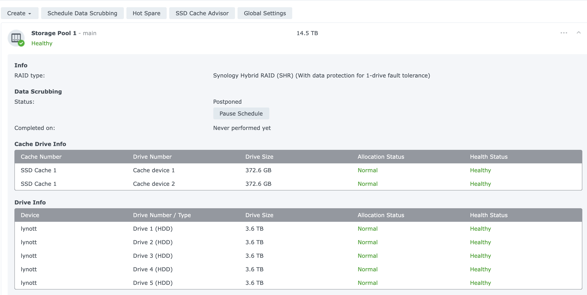
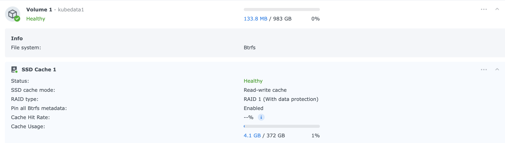
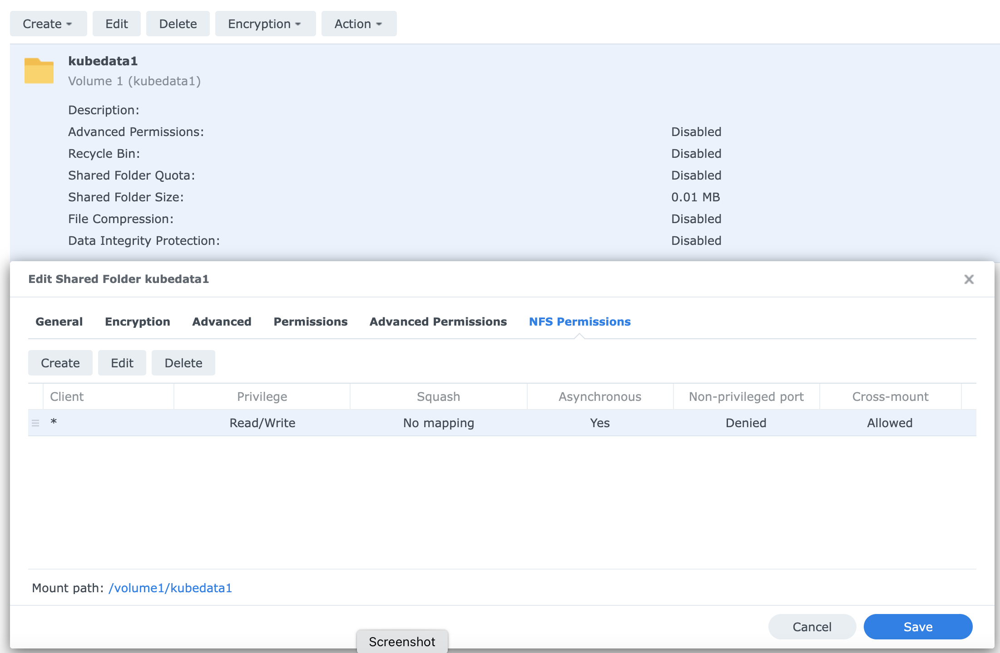
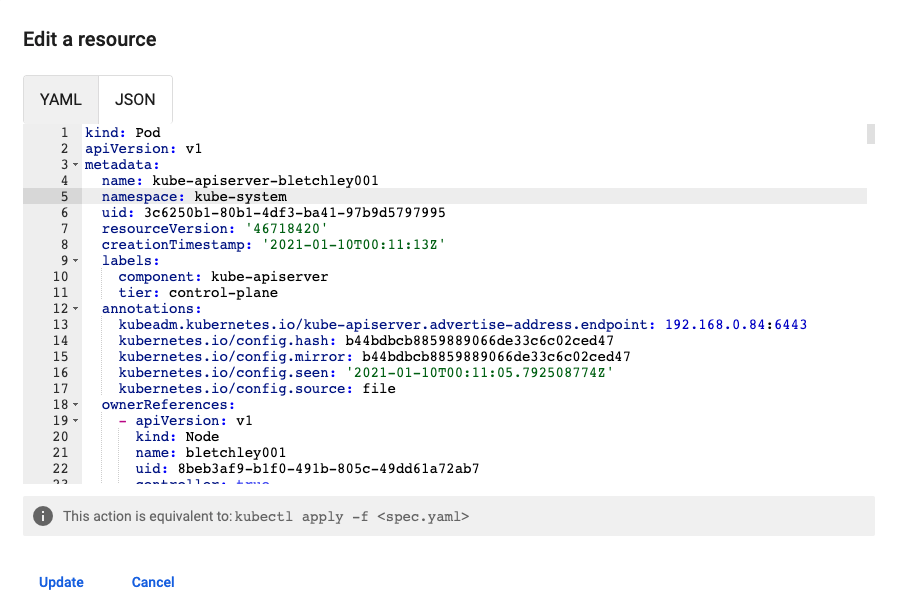

# Cluster Maintenance and Operations

This document contains detailed information on the initial setup, routine maintenance, and hardening of the home Kubernetes cluster.

## Initial Setup

### Pi SSH Setup
As a prerequisite to running ansible automation against hosts in the cluster, we first need to add ssh authorized users to each host. Relevant public keys are stored in my github account at: https://github.com/bpafoshizle.keys. Adding these keys to `~/.ssh/authorized_keys` on the managed node allows ansible commands to be executed on the control node without username and password prompts.

The [00-get-ssh-authorized-users.sh](../../deploy/00-get-ssh-authorized-users.sh) script can be run on each managed node to add the ssh keys for control nodes.

### Links and Tutorials Followed
- [Primary Kube on Pis Article](https://opensource.com/article/20/6/kubernetes-raspberry-pi)
- [Ubuntu's Guide to installing on RPi](https://ubuntu.com/tutorials/how-to-install-ubuntu-on-your-raspberry-pi#4-boot-ubuntu-server)
- [Ansible smoke test](https://www.digitalocean.com/community/tutorials/how-to-install-and-configure-ansible-on-ubuntu-20-04)
- [Ansible inventory config docs](https://docs.ansible.com/ansible/latest/user_guide/intro_inventory.html#id8)

## Commands for setup

Command to test some variables:
```bash
ansible-playbook -i ./ansible/inventory/hosts ./ansible/99-test.yml
```

Command to check validity of main config: 
```bash
ansible-playbook -i ./ansible/inventory/hosts ./ansible/01-kube.yml --check
```

Command to run kube setup playbook:
```bash
./deploy/01-run-kube-playbook.sh
```

---

## Hardening

### Background
Hardening playbook uses a community galaxy role for [fail2ban](https://github.com/robertdebock/ansible-role-fail2ban). To use:

```bash
mkdir ./ansible/roles
ansible-galaxy install --roles-path ./ansible/roles robertdebock.fail2ban
```

### Commands for hardening
Check validity: 
```bash
ansible-playbook -i ./ansible/inventory/hosts ./ansible/02-harden.yml --check
```

Run hardening:
```bash
./deploy/02-run-harden-playbook.sh
```

---

## Setting up Persistent Storage (NFS)

The cluster uses [Kubernetes NFS Subdir External Provisioner](https://github.com/kubernetes-sigs/nfs-subdir-external-provisioner) for dynamic provisioning via a Synology NAS (hostname: `lynott`).

### Preconfiguration
1. **NAS Setup**: Configured storage pool, volume, and shared NFS folder.
   - 
   - 
   - 
2. **NFS Security**: Configured to allow cluster hosts. Root mapping (`no_root_squash` or `map all users to admin`) is generally required since kube services run as root.
3. **Static IP**: Reserved NAS IP in router.

### Deployment
```bash
cd kube/nfs-subdir-external-provisioner
kubectl apply -f deploy/rbac.yaml
kubectl apply -f deploy/deployment.yaml
kubectl apply -f deploy/class.yaml
```

---

## Cluster Monitoring

### Kubernetes Dashboard
Deploy the dashboard:
```bash
cd deploy && source 04-01-deploy-kubernetes-dashboard.sh 
```

To get the bearer token for the `admin-user` service account:
```bash
kubectl get secret admin-user -n kubernetes-dashboard -o jsonpath={".data.token"} | base64 -d
```

Access via port-forward:
```bash
kubectl -n kubernetes-dashboard port-forward svc/kubernetes-dashboard-kong-proxy 8443:443
```
Then navigate to: https://localhost:8443/

### Metrics Server
Metrics server enables Resource (CPU/Memory) usage viewing in the dashboard.
```bash
kubectl apply -f kube/metrics-server/components.yaml
```

Note: Needs aggregator routing enabled in `kube-apiserver`.


```bash
ansible-playbook -i ./ansible/inventory/hosts ./ansible/01-kube.yml --tags kube-apiserver-enable-aggregator --check
```

---

## Common Maintenance Commands

### Health & Monitoring
Check CPU temps:
```bash
ansible -i ./ansible/inventory/hosts -u ubuntu --become all -m shell -a "cat /sys/class/thermal/thermal_zone*/temp"
```

Check disk usage:
```bash
ansible -i ./ansible/inventory/hosts -u ubuntu --become all -m shell -a "df -h | grep /dev/mmcblk0p2"
```

### Certificates
Check Kubernetes certificate expiration:
```bash
ansible -i ./ansible/inventory/hosts -u ubuntu --become kubecontrol -m shell -a "kubeadm certs check-expiration"
```

Renew certificates:
```bash
ansible-playbook -i ./ansible/inventory/hosts ./ansible/99-renew-kube-certs.yml
```

### Cluster Operations
Reboot all hosts:
```bash
./deploy/99-reboot-all.sh
```

Shutdown all hosts:
```bash
ansible -i ./ansible/inventory/hosts all -m command -a "shutdown -h now" -u ubuntu --become
```

Update system packages:
```bash
ansible-playbook -i ./ansible/inventory/hosts ./ansible/99-update.yml
```

---

## SD Card Failure & Recovery

As cluster nodes age, SD cards (especially on high-write control plane nodes) are prone to wear out. Below is a guide on diagnosing card failures and the recovery/cloning procedure.

### Symptoms of SD Card Failure

1. **Read-Only Lockout (RAM execution):**
   * **Symptoms:** Node is pingable, but SSH returns `Connection refused` or `Connection reset by peer`. Local pods crash with `SIGBUS` (exit code 135) when trying to write to databases or memory-mapped files (like SQLite WAL files).
   * **Cause:** The SD card's internal flash controller has permanently locked itself into read-only mode to prevent data loss.

2. **Boot Failure (Stuck on Rainbow Screen):**
   * **Symptoms:** Connecting a monitor to the Pi shows a static rainbow screen (GPU test card) and absolutely no console output.
   * **Cause:** The bootloader cannot read `bootcode.bin` or `start4.elf` from the boot partition because the card is either physically dead or corrupted.

### Diagnostics on macOS

Insert the SD card into your MacBook and run:
```bash
diskutil list       # Find the disk identifier (e.g., disk4)
diskutil info disk4s2
```
Look for the `Media Read-Only` flag:
* If it says **`Media Read-Only: Yes`**, check the physical plastic sliding switch on the side of the SD card adapter. Ensure it is pushed up (away from the word "LOCK").
* If it is physically unlocked but still reports `Yes`, the card's flash controller has reached its write-cycle limit and failed into read-only mode.

### Recovery Procedure: Cloning to a New Card

If the card is read-only but still readable, you can clone its exact state onto a new (possibly larger) SD card, preserving all configuration, certificates, ssh keys, and the `etcd` cluster database.

#### 1. Clone the Old Card to a Disk Image
With the old card plugged into your Mac (assuming it is `disk4`):
```bash
diskutil unmountDisk disk4
sudo dd if=/dev/rdisk4 of=~/rpi-node-backup.img bs=4M status=progress
```

#### 2. Flash to the New Card
Insert your new SD card (assuming it is detected as `diskX`):
```bash
diskutil unmountDisk diskX
sudo dd if=~/rpi-node-backup.img of=/dev/rdiskX bs=4M status=progress
```

#### 3. Online Partition & Filesystem Extension (on the Pi)
After writing the image, insert the new card into the Pi and power it on. The Pi's Linux kernel will automatically replay the dirty filesystem journal and boot up. 

> [!NOTE]
> Ubuntu Server on Raspberry Pi typically auto-grows the partition and filesystem to fill the disk on the first boot. Run `df -h` to verify. If it has already expanded, no further action is needed.

If it did not auto-expand, you can manually expand the partition and filesystem online once you SSH into the Pi:
```bash
# Grow the partition boundary
sudo growpart /dev/mmcblk0 2

# Resize the ext4 filesystem to fill the grown partition
sudo resize2fs /dev/mmcblk0p2
```
